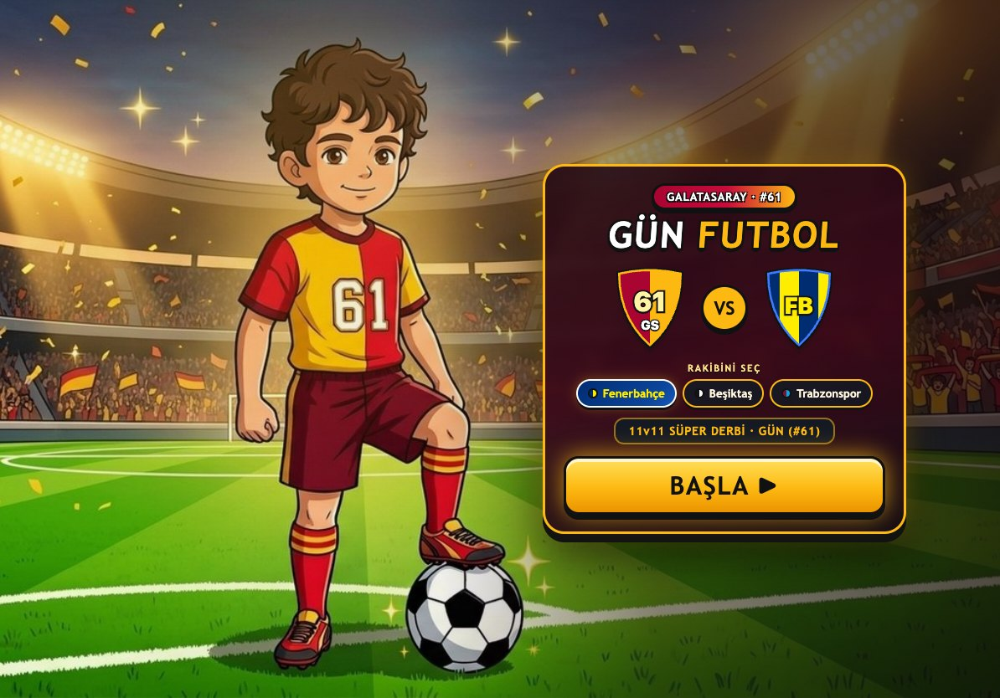
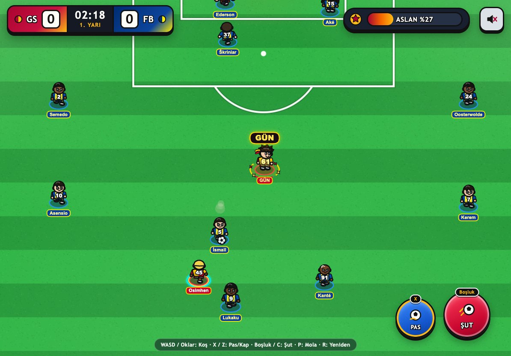
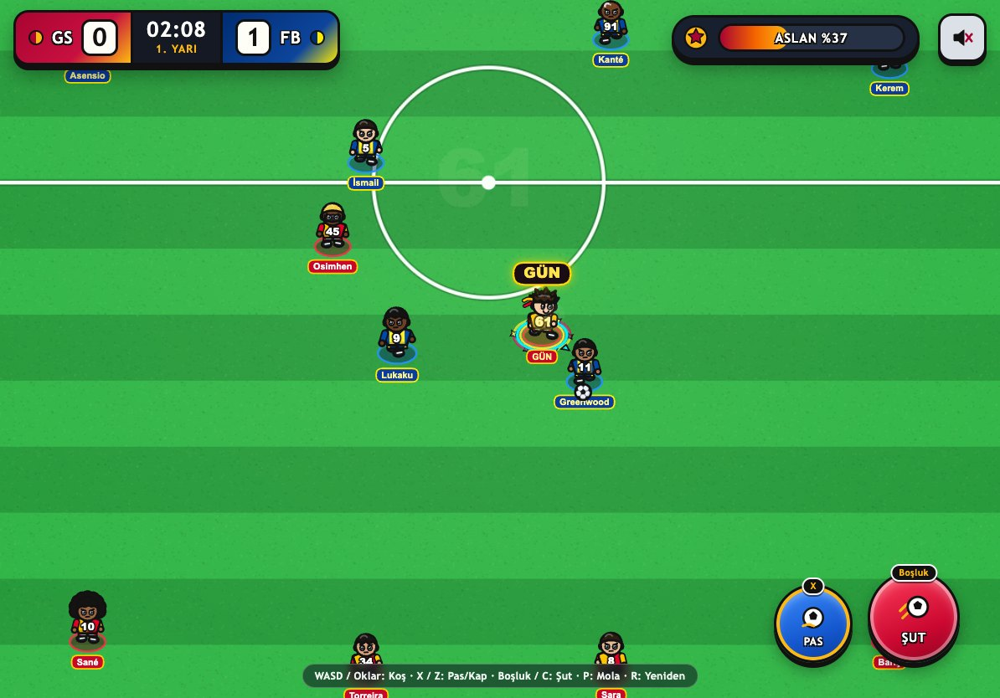
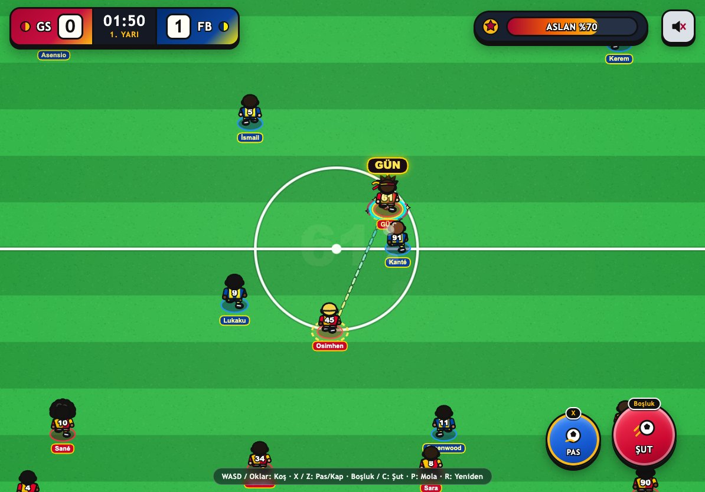

# Gün Futbol ⚽🦁

5 yaşındaki Gün için yapılmış, çizgi roman havasında bir futbol oyunu. Gün, **Galatasaray**'ın 61 numaralı kaptanıdır;
Osimhen, Barış Alper, Sané ve arkadaşlarıyla birlikte 11'e 11 derbiye çıkar. Rakip olarak **Fenerbahçe, Beşiktaş ya da Trabzonspor**
seçilir. Maç iki devredir, her devre 2,5 dakika sürer. Türkçe spiker her pozisyonu anlatır, tribün tezahürat yapar.

**Oyna:** https://goktugkarpat.github.io/gun-futbol/

## Oyunda neler var

- **11'e 11 gerçek kadrolar:** Galatasaray ve seçilen rakibin oyuncuları; spiker topu alan her futbolcunun adını söyler.
- **Gün hep göz önünde:** başının üstündeki sarı **GÜN** rozetiyle sahada hemen bulunur; kamera topu yakından izler.
- **Aslan Şutu:** oynadıkça dolan Aslan Gücü tamamlanınca ŞUT düğmesi alevlenir; basınca durdurulması çok zor, ateşli özel bir şut çıkar.
- **Kaleciler topu tutar:** şutları ve ortaları yakalar, sonra elle pas verir ya da uzun degaj yapar.
- **Duran toplar:** taç, korner ve aut atışlarında nişan oku ve güç çubuğu çıkar.
- **Tribün:** maç boyunca uğultu, aralarda "Cim Bom Bom" tezahüratları; gol olunca tribün patlar, kurtarışta alkış,
  top direkten dönünce "ooo" sesi gelir.
- **Maç sonu:** kazanana kupa töreni; beraberlikte **Altın Gol** (ilk golü atan kazanır).

| | |
|---|---|
|  |  |

## Nasıl açılır

- **İnternette:** https://goktugkarpat.github.io/gun-futbol/
- **iPad'de uygulama gibi (önerilen):**
  1. iPad'de **Safari**'yi aç ve yukarıdaki adrese git.
  2. **Paylaş** düğmesine dokun (kutudan yukarı çıkan ok).
  3. Listeden **Ana Ekrana Ekle**'yi seç, sonra **Ekle**'ye dokun.
  4. Ana ekranda oyunun simgesi belirir; ona dokununca oyun tam ekran, uygulama gibi açılır.
  5. Bir kez açıldıktan sonra **internetsiz de çalışır** (arabada, uçakta).
- **Android tablette:** adresi Chrome'da aç, sağ üstteki üç nokta › **Ana ekrana ekle**.
- **Bilgisayarda:** adresi tarayıcıda aç ya da klasördeki `index.html` dosyasına çift tıkla. Kurulum gerekmez.
- **Yeni sürüm gelince:** internet varken oyunu kapatıp yeniden aç; kendiliğinden güncellenir.
- Tableti **yatay** tut; ses için tabletin sessiz düğmesinin kapalı olduğundan emin ol.

## Nasıl oynanır

1. Giriş ekranında rakibi seç (Fenerbahçe, Beşiktaş ya da Trabzonspor) ve **BAŞLA**'ya dokun.
2. Topu rakip kaleye götür ve gol at. Süre bitince en çok gol atan kazanır.

### Tablette (dokunarak)

| Ne yapmak istiyorsun | Nasıl |
|---|---|
| Koşmak | Ekranın **sol yarısına** parmağını koy ve gitmek istediğin yöne sürükle |
| Pas vermek / topu kapmak | Sağ alttaki **PAS** düğmesi (top rakipteyken aynı düğme topu kapar) |
| Şut çekmek | Sağ alttaki **ŞUT** düğmesi (basılı tutarsan şut güçlenir) |
| Aslan Şutu | Aslan Gücü dolunca alevlenen **ŞUT** düğmesi |

### Bilgisayarda (klavyeyle)

| Tuş | Ne yapar |
|---|---|
| `W A S D` ya da ok tuşları | Koş |
| `X` ya da `Z` | Pas ver / topu kap |
| `Boşluk` ya da `C` | Şut çek / Aslan Şutu |
| `P` | Mola |
| `R` | Maçı yeniden başlat |

Top sendeyken hep topa en yakın Galatasaraylıyı yönetirsin; pas verince kontrol pası alan oyuncuya geçer.
Kaleci topu tutunca **PAS** ile yakındaki arkadaşına verir, **ŞUT** ile ileriye degaj yapar.

## Ebeveyn için notlar

- **Süre:** bir maç yaklaşık 5–6 dakika sürer (2 × 2,5 dakika, devre arası ve varsa Altın Gol).
- **Okuma gerekmez:** her şey spikerin sesiyle ve büyük düğmelerle anlatılır. Spiker doğal bir Türkçe sesle önceden kaydedildi.
- **Korkutucu ya da sert bir şey yok:** faul, kart, sakatlık yoktur.
- **Ses:** spiker, tribün ve efektlerden oluşur; tabletin ses düğmesiyle ayarlanır.
- **Kişisel veri toplanmaz;** oyun internetsiz çalışır.
- **Sessiz açmak için** adresin sonuna `?sessiz` ekle.
- **GitHub'a göndermek:** klasördeki `yayinla.command` dosyasına çift tıkla.

## Yapım

Bu oyun, Gün için **Göktuğ Karpat** (@goktugkarpat) ile yapay zekâ yardımcıları **Claude Code** (Anthropic), **Codex** (OpenAI) ve **Antigravity** (Google) birlikte çalışarak yapılmıştır.
Fikirler ve kararlar ailenindir; kod, çizimler, sesler ve seslendirme düzenlemeleri bu yardımcılarla birlikte hazırlanmıştır.
Takım ve futbolcu adları yalnızca bir çocuğun sevdiği takımla oynayabilmesi için kullanılmıştır; oyun hiçbir kulüp ya da lig ile bağlantılı değildir ve kâr amacı olmadan yapılmış bir aile projesidir.
